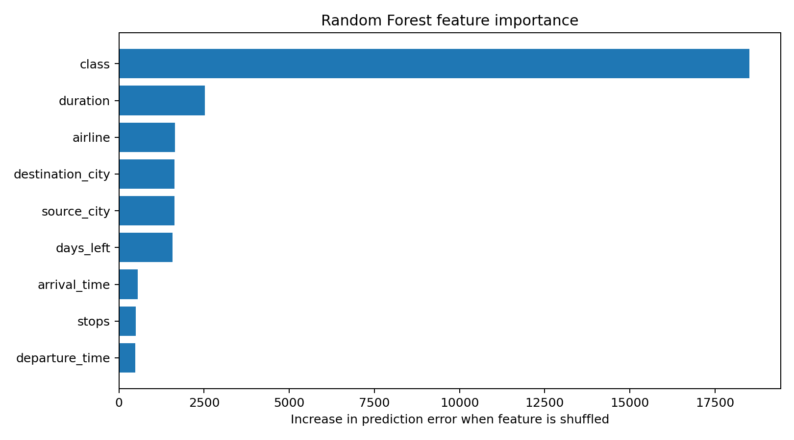
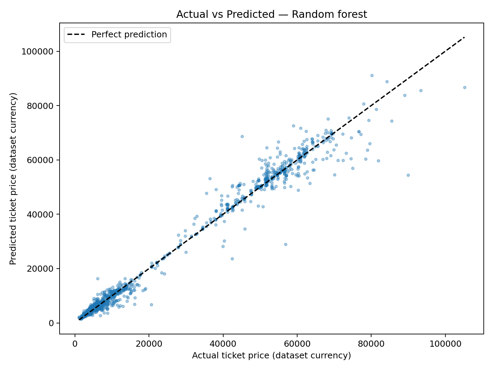
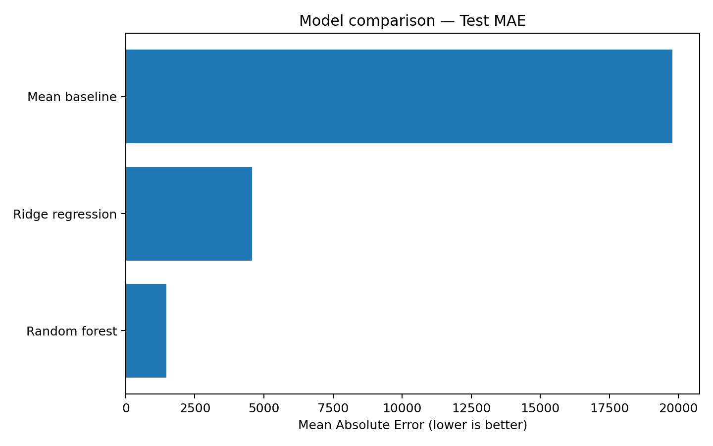

# Airline Flight Price Analysis and Prediction

A Python Data Science project that analyses airline ticket prices and uses machine learning to predict prices based on flight characteristics.

## Project Overview

This project includes:
- Data cleaning and Exploratory Data Analysis (EDA)
- Data visualisation
- Machine learning model training and comparison
- Model evaluation and validation
- Feature importance analysis

## Dataset

The dataset contains approximately **300,153 airline flight records** and was obtained from Kaggle.

**Dataset Creator:** Rohit Grewal

**Download Dataset:** https://www.kaggle.com/datasets/rohitgrewal/airlines-flights-data

### How to Download the Dataset

1. Open the Kaggle link above.
2. Click Download.
3. Extract the ZIP file if necessary.
4. Place `airlines_flights_data.csv` in the main project folder alongside the Python scripts.

**Note:** The dataset is not included in this GitHub repository and must be downloaded separately.

## Tools and Libraries

Python, pandas, NumPy, Matplotlib, Seaborn and scikit-learn.

## Machine Learning Results

Three models were trained and evaluated using an 80/20 training and testing split.

| Model | MAE (₹) | R² |
|---|---:|---:|
| Mean Baseline | 19,779.74 | ~0.0000 |
| Ridge Regression | 4,576.93 | 0.9109 |
| **Random Forest** | **1,467.12** | **0.9833** |

Best Model: Random Forest Regression, achieving an R² score of **0.9833 (98.33%)** on the random test dataset.

Additional testing on unseen flight IDs achieved an R² score of **0.9494**.

## Visualisations

### Feature Importance



### Actual vs Predicted Prices



### Model Comparison



## Project Files

- `temp.py` — Data exploration and visualisation.
- `price_prediction.py` — Machine learning model training and evaluation.
- `validate_airline_model.py` — Model validation and feature importance.
- `images/` — Exploratory analysis graphs.
- `ml_results/` — Machine learning results and visualisations.
- `requirements.txt` — Required Python libraries.
- `analysis_summary.txt` — Summary of the data analysis.

## How to Run

1. Download this GitHub repository.
2. Download the dataset from the [Kaggle link](https://www.kaggle.com/datasets/rohitgrewal/airlines-flights-data).
3. Place `airlines_flights_data.csv` in the project folder.
4. Open the project in VS Code.
5. Run the following commands in the terminal:

```bash
python -m pip install -r requirements.txt
python temp.py
python price_prediction.py
python validate_airline_model.py
```

## Limitations

The models were trained using historical flight data and may not accurately predict current airline ticket prices. Performance may also decrease when predicting unfamiliar flight patterns.

## Author

R-Murangi — Aspiring Data Scientist

GitHub: https://github.com/R-Murangi
